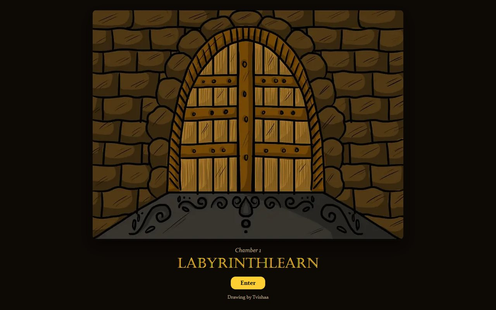
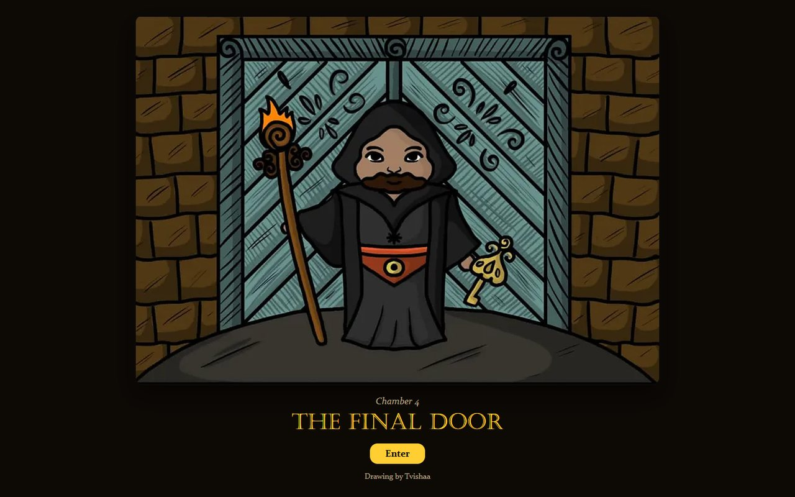
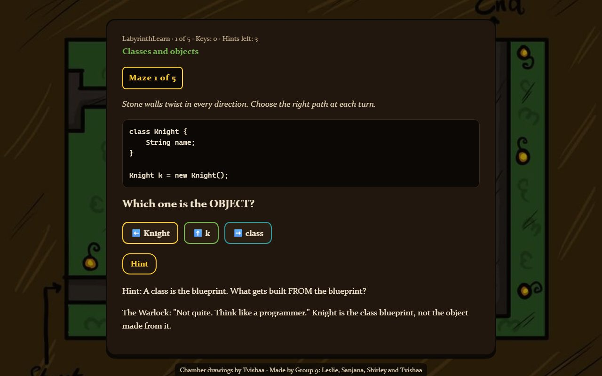
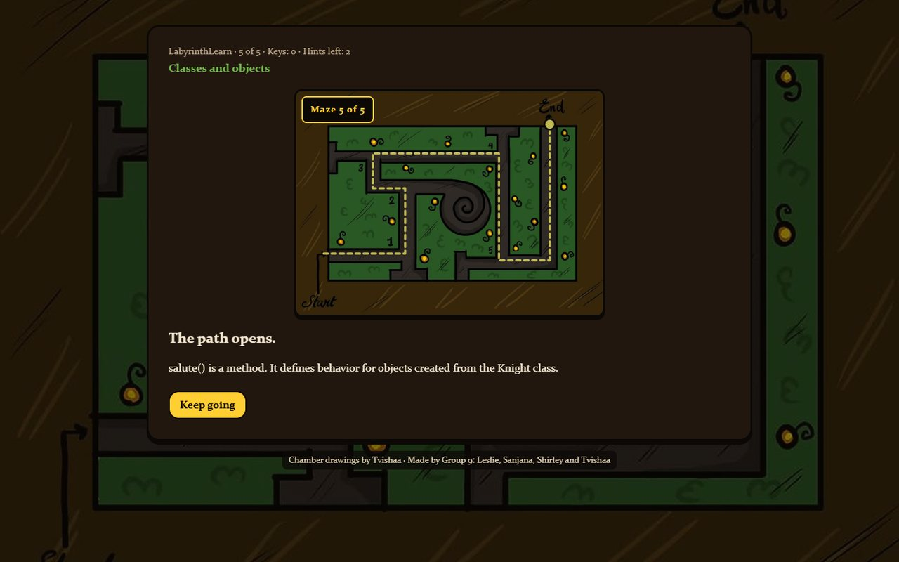
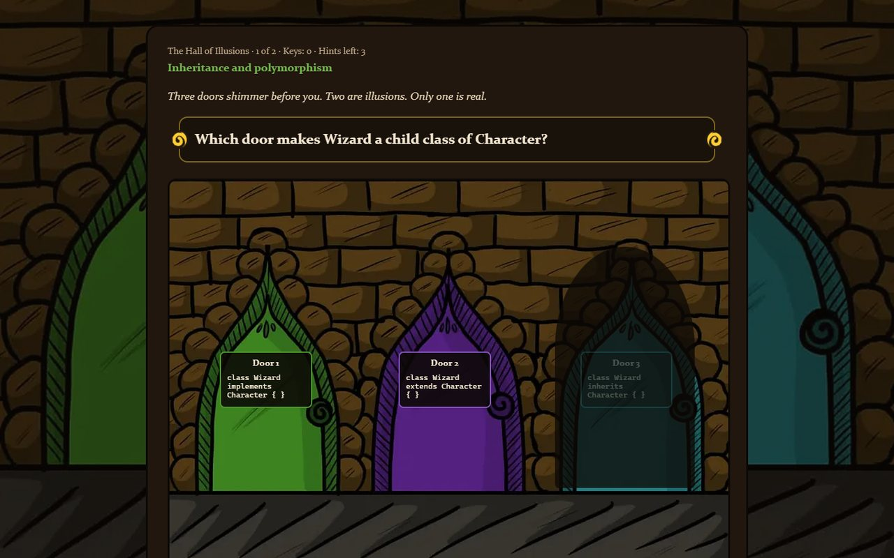
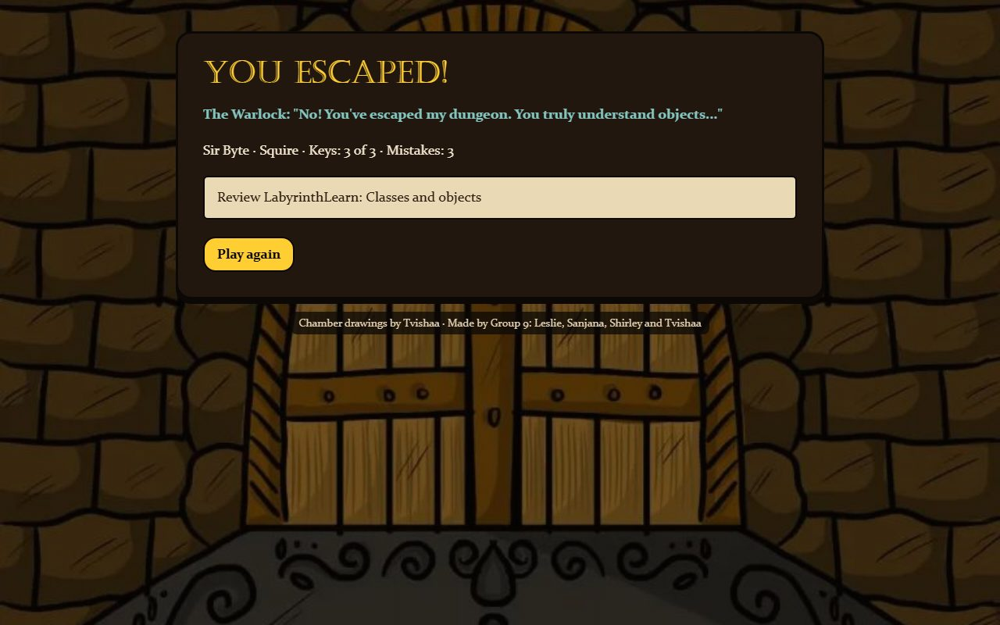
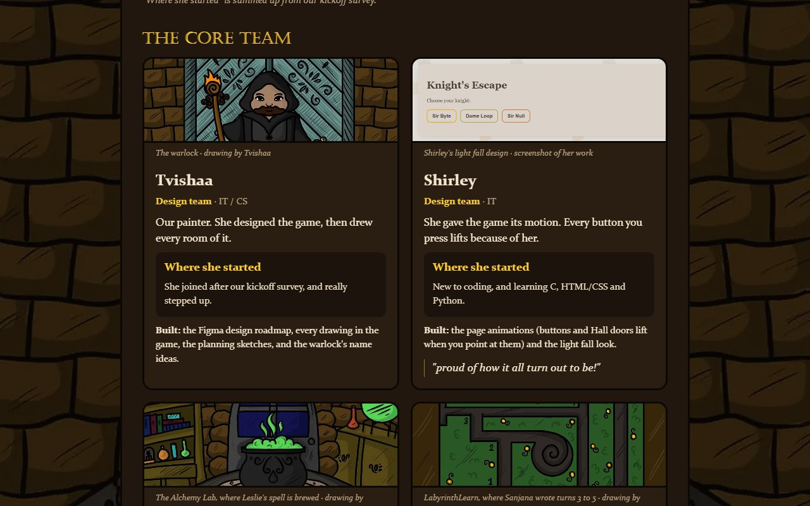

# Knight's Escape: An OOP Quest

**A warlock has trapped you in his dungeon. The only way out is to read the code.**

Knight's Escape is a browser escape room that teaches Java object-oriented programming. You pick a knight, then get through four chambers, each one locked with a different OOP concept. Every wrong answer tells you *why* it was wrong, and every key you earn becomes a flashcard.

<p>
  
  
  
  
  <br>
  
  
  
</p>


## Play it

**▶ [Play Knight's Escape](https://kateye31.github.io/Knights-Escape.-An-OOP-Quest/)** in your browser. Nothing to install, and it works on phones.

Or download this repo and open `index.html`. It runs offline too.

**🎬 [Watch the 2-minute demo](docs/video/knights-escape-demo.webm)**: a calm play-through of all four chambers, then how we built it. Captions only, no sound.

### Every chamber opens on Tvishaa's drawing

When you walk into a new chamber, her full drawing shows first, uncropped, with the chamber number and name ("Chamber 1 · LabyrinthLearn"). It waits for you: click **Enter**, click anywhere, or press any key to step inside. Chamber 1 opens on her castle door, since that's the way into the maze.

### Her drawings come alive

The puzzles now happen *on* her drawings instead of just in front of them:

| Chamber | What happens on the drawing |
| --- | --- |
| 🌿 **LabyrinthLearn** | Your knight is a dot in your knight's color, standing at her **Start** arrow. Each right answer walks it down the corridor to her next hand-drawn number (1 → 5, then **End**), leaving a trail. A wrong turn bumps it into the wall that way. The answer buttons use **her drawn arrows** instead of emoji. The arrows are a trick, though: they don't match the map, and the warlock warns you under the drawing to trust the code, not the picture. |
| ⚗️ **The Alchemy Lab** | Her cauldron reacts. A right answer sends up green bubbles and the spell word rises out of the brew. A wrong one turns it murky. |
| 🚪 **The Hall of Illusions** | Each door's code sits **on her drawn door**. Pick a wrong one and that door fades into the wall (it was an illusion); the real one glows. On phones the code is too small to read on the doors, so it also shows underneath. |
| 🗝️ **The Final Door** | Her warlock stands guard with **three keyholes** that fill in as you earn each key. |

The warlock's speeches sit in a question box framed with the spiral from her door knob.

<table>
  <tr>
    <td width="50%"></td>
    <td width="50%"></td>
  </tr>
  <tr>
    <td><b>Chamber 1</b> opens on her Maze door.</td>
    <td><b>Chamber 4:</b> the warlock guards the Final Door.</td>
  </tr>
</table>

### From her sketches to the game

Tvishaa planned every screen on paper first: the Maze door, the maze layout with the question box under it, the code displays on the Hall doors, the warlock guarding the Final Door, and the curly question-box frame. The game follows those sketches.


## The quest

| | Chamber | What you do | OOP concept |
| --- | --- | --- | --- |
| 🏰 | **Start** | Pick your knight (Sir Byte, Dame Loop, Sir Null) and a difficulty | |
| 🧙 | **The warlock** | He locks you in and dares you to escape | |
| 🌿 | **LabyrinthLearn** | 5 turns. Pick the right direction by answering the code question | Classes, objects, constructors |
| ⚗️ | **The Alchemy Lab** | Guess what each potion's code prints. The words build a spell | Methods, return values, encapsulation |
| 🚪 | **The Hall of Illusions** | Three look-alike doors. Only one has code that works | Inheritance, polymorphism |
| 🗝️ | **The Final Door** | Answer the warlock in your own words to earn 3 keys | Explain it yourself |
| 🏆 | **Escape** | Your keys, your mistakes, and which chamber to review | |

Difficulty sets your hints per chamber: **Squire** 3, **Knight** 2, **Champion** 1.

<table>
  <tr>
    <td width="50%"></td>
    <td width="50%"></td>
  </tr>
  <tr>
    <td><b>The warlock's welcome,</b> in her question-box frame.</td>
    <td><b>The Hall of Illusions.</b> The code sits on her doors.</td>
  </tr>
  <tr>
    <td></td>
    <td></td>
  </tr>
  <tr>
    <td><b>LabyrinthLearn.</b> Her drawn arrows on the buttons. A wrong turn tells you exactly what you mixed up.</td>
    <td><b>Turn 5 right:</b> the knight reaches her End.</td>
  </tr>
  <tr>
    <td></td>
    <td></td>
  </tr>
  <tr>
    <td><b>The Alchemy Lab.</b> Right answers bubble green. Four of them spell <i>"Squire doing king's work."</i></td>
    <td><b>The Hall of Illusions.</b> A wrong door fades into the wall.</td>
  </tr>
  <tr>
    <td></td>
    <td></td>
  </tr>
  <tr>
    <td><b>Key flashcards.</b> Each key fills a keyhole and gives you something to remember.</td>
    <td><b>Escape.</b> The scroll tells you which chamber to review.</td>
  </tr>
</table>

<p align="center"><br><b>Works on phones too.</b></p>

## Meet the creators

The game has a **Meet the creators** page (top right of the game, or at the end of your quest): who we are, where each of us started, what we built, and the story from our first brainstorm to the final game. It fades in through black and drops you back exactly where you left your quest.



| | Role | What she built |
| --- | --- | --- |
| **Tvishaa** | Design team | The game design, mapped in Figma (a warlock, four chambers, how each one plays), **every drawing in the game**, and the **planning sketches** that set where everything goes. Her vote made it an escape room. The game's colors come from her art. |
| **Shirley** | Design team | The **page animations**: buttons and the Hall doors lift when you point at them. Plus the light fall look we compared at the final meeting. |
| **Leslie** | Dev team | The **Alchemy Lab spell** (*"Squire doing king's work,"* ending on encapsulation), the name LabyrinthLearn, the **mistake counter** and the **weak-spot scroll**. |
| **Sanjana** | Dev team | The **OOP research** the chambers follow, LabyrinthLearn turns 3–5, **wrong-answer explanations**, the maze counter, and **keys as flashcards**. |
| **Katrina** | Project lead | Starter code, task guides and code reviews. |

We're Group 9, Project 9 with Girls Who Code at UCF. We picked the name, the colors and the look together in votes at our meetings.

## Design

- **Art:** all five scenes are Tvishaa's own drawings (in [`art/`](art/)). Each chamber opens on a title card with her full drawing, then the puzzle plays out on top of it. The maze arrows and the door-knob spiral are cut from her drawings too. The files are cleanly upscaled 2× so they stay sharp on big screens, and they always keep their own shape (never stretched).
- **Colors:** pulled straight from her drawings: brick and wood browns, maze-coin gold, hedge green, and the green, purple and teal of her three Hall doors, which the code doors match.
- **Fonts:** Microsoft fonts that come with Windows and Office. **Castellar** (carved capitals) for big titles, **Constantia** for reading, **Cascadia Mono** / Consolas for code. On computers without them (most Macs and phones), titles and text fall back to Georgia.
- **Motion:** Shirley's hover lift on every button, a quiet crossfade from each title card into its chamber, the knight walking the maze, the cauldron bubbling and the Hall doors fading. All of it turns off for anyone whose computer asks for reduced motion (the knight just appears at its next stop).

## How the code works

| File | What's in it |
| --- | --- |
| [`rooms.js`](rooms.js) | All the content: story, Java snippets, questions, hints, wrong-answer explanations. Edit this to change a puzzle. |
| [`scenes.js`](scenes.js) | Tvishaa's drawings and what happens on them: the title cards, the knight's route through her maze, the cauldron, the code on the Hall doors and the warlock's keyholes. |
| [`game.js`](game.js) | How the screens work: one function per screen, plus hints, taunts, keys and the escape screen. It calls the helpers in `scenes.js`. |
| [`style.css`](style.css) | Colors (the `:root` block at the top), fonts, layout, the chamber backgrounds, the scene effects, and Shirley's animations. |
| [`about.js`](about.js) | The **Meet the creators** page: the fade through black between it and the game, and picking your quest back up. |
| [`index.html`](index.html) | The page itself: the game, the title card and the Meet the creators page. Loads `rooms.js`, `scenes.js`, `game.js` and `about.js`. |
| [`art/`](art/) | Tvishaa's drawings (`tvishaa-*.jpg`) and Figma roadmap, the arrows and spiral cut from her drawings, Shirley's design screenshot, and the Girls Who Code UCF logo. |
| [`docs/`](docs/) | The [team guide](docs/TEAM-GUIDE.md) (setup, git, how to write a puzzle), the [welcome page](docs/WELCOME.md) and README screenshots. |

Every puzzle is plain data, so adding one means copying a block in `rooms.js`:

```js
{
  code: "Knight a = new Knight();\nKnight b = a;",
  question: "How many different Knight objects are referenced here?",
  choices: ["⬅️ 1", "⬆️ 2", "➡️ 0"],
  answer: 0,
  hint: "Assigning one variable to another copies the reference, not the object.",
  explain: "Only one object is created. Both a and b refer to that same Knight object.",
  wrong: ["", "b = a copies a reference; it does not create a second object.", "The new Knight() expression creates one object."],
},
```

To pick which drawing sits behind a screen, `game.js` passes a scene name to `show()`, like `show(html, "maze")`. When you first walk into a chamber, it calls `titleCard("lab", "Chamber 2", LAB.title)` from `scenes.js`, which shows `art/tvishaa-lab.jpg` full size until you click Enter.

Things placed on a drawing (the knight, the cauldron bubbles, the door code) use **percentages of the picture**: `[0, 0]` is the top-left corner and `[100, 100]` the bottom-right. So if the knight walks through a hedge, fix its corner in `MAZE_ROUTE` at the top of the maze section in `scenes.js`:

```js
const MAZE_ROUTE = [
  [[9, 72.5]],               // Start (her arrow)
  [[35.5, 72.5]],            // 1
  [[35.5, 43.5]],            // 2
  [[25, 43.5], [25, 36]],    // 3 (two corners to get there)
  ...
];
```

The Hall doors work the same way in `HALL_DOORS`, and the cauldron's spot is `CAULDRON`.

## Contributing

Every change goes through a branch and a pull request. The step-by-step version (clone, branch, commit, push, pull request) is in **[docs/TEAM-GUIDE.md](docs/TEAM-GUIDE.md), Part 3**.

---

Made for Girls Who Code, Project 9 · Fall 2026 · All art by Tvishaa.
