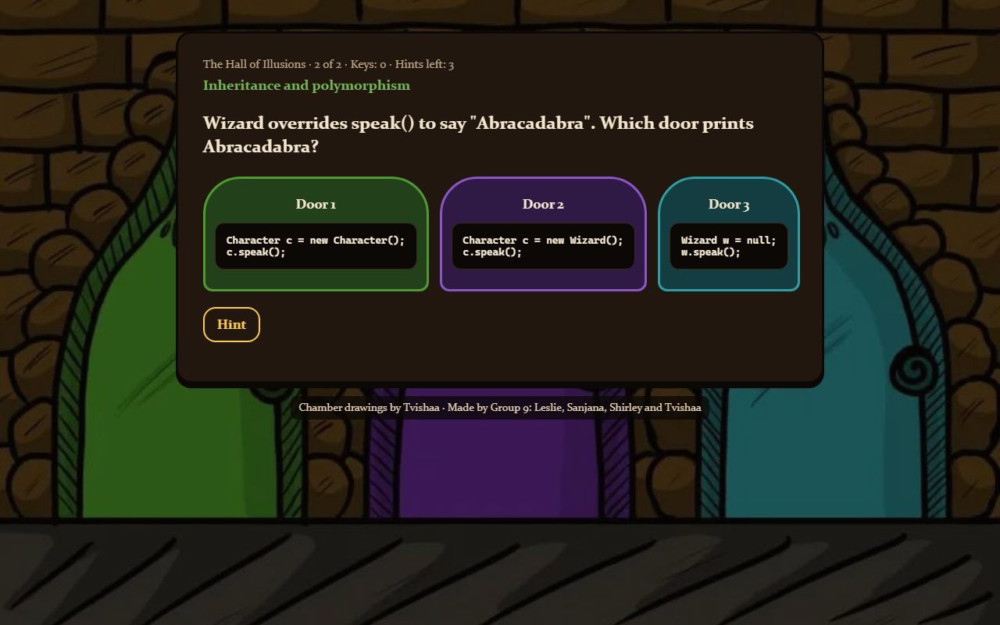
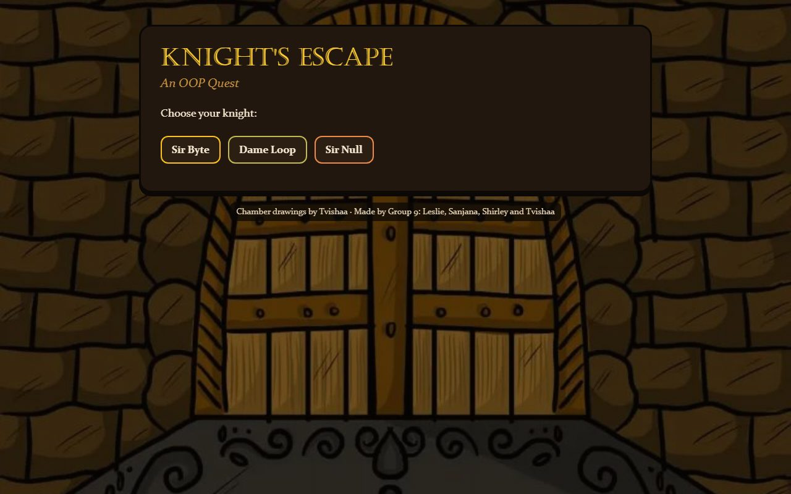
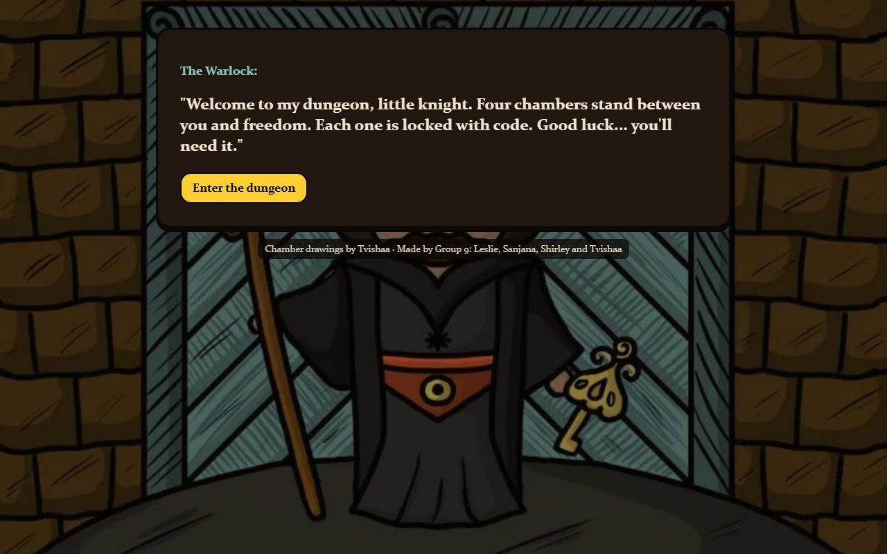
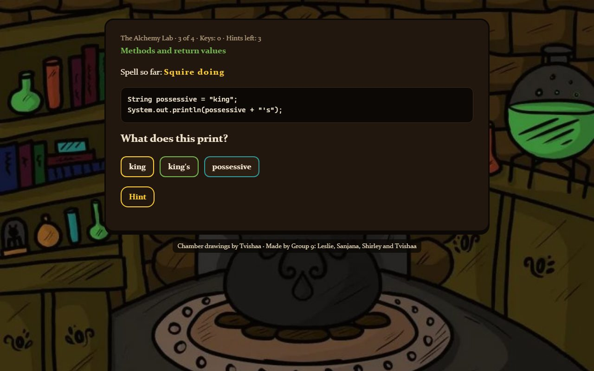
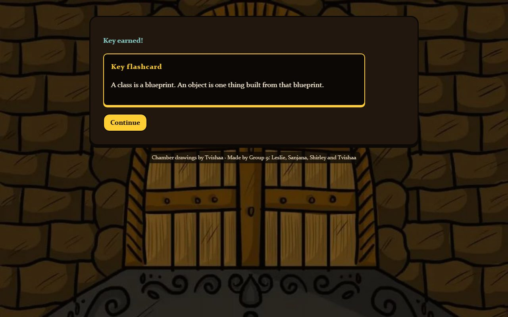
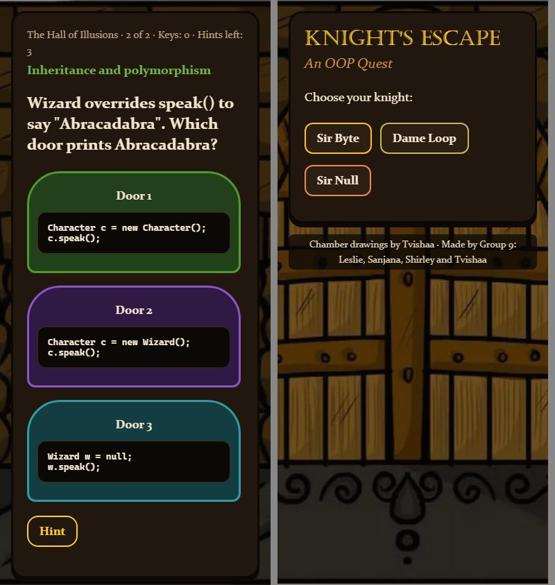

# Knight's Escape: An OOP Quest

**A warlock has trapped you in his dungeon. The only way out is to read the code.**

Knight's Escape is a browser escape room that teaches Java object-oriented programming. You pick a knight, then get through four chambers, each one locked with a different OOP concept. Every wrong answer tells you *why* it was wrong, and every key you earn becomes a flashcard.

<p>
  
  
  
  
  <br>
  
  
  
</p>



## Play it

Download or clone this repo and open `index.html` in any browser. There's nothing to install and no internet needed.

## The quest

| | Chamber | What you do | OOP concept |
| --- | --- | --- | --- |
| 🏰 | **Start** | Pick your knight (Sir Byte, Dame Loop, Sir Null) and a difficulty | |
| 🧙 | **The warlock** | He locks you in and dares you to escape | |
| 🌿 | **LabyrinthLearn** | 5 turns. Pick the right direction by answering the code question | Classes, objects, constructors |
| ⚗️ | **The Alchemy Lab** | Guess what each potion's code prints. The words build a spell | Methods, return values, encapsulation |
| 🚪 | **The Hall of Illusions** | Three look-alike doors. Only one has code that works | Inheritance, polymorphism |
| 🗝️ | **The Final Door** | Answer the warlock in your own words to earn 3 keys | Explain it yourself |
| 🏆 | **Escape** | Your keys, your mistakes, and which chamber to review | |

Difficulty sets your hints per chamber: **Squire** 3, **Knight** 2, **Champion** 1.

<table>
  <tr>
    <td width="50%"></td>
    <td width="50%"></td>
  </tr>
  <tr>
    <td><b>Choose your knight.</b> The castle door is where it starts and ends.</td>
    <td><b>The warlock.</b> He holds the key you're after.</td>
  </tr>
  <tr>
    <td></td>
    <td></td>
  </tr>
  <tr>
    <td><b>LabyrinthLearn.</b> A wrong turn tells you exactly what you mixed up.</td>
    <td><b>The Alchemy Lab.</b> Four right answers spell <i>"Squire doing king's work."</i></td>
  </tr>
  <tr>
    <td></td>
    <td></td>
  </tr>
  <tr>
    <td><b>Key flashcards.</b> Every key you earn is something to remember.</td>
    <td><b>Escape.</b> The scroll tells you which chamber to review.</td>
  </tr>
</table>

<p align="center"><br><b>Works on phones too.</b></p>

## Who made what

We're Group 9 (Girls Who Code, Project 9): four students and a mentor.

| | What she built |
| --- | --- |
| **Tvishaa** · Design | The game design (the Group 9 design roadmap: a warlock, four chambers) and **every drawing in the game**: the castle door, the warlock, the maze, the alchemy lab and the three doors. The game's colors come from her art. |
| **Shirley** · Design | The **page animations**: buttons lift when you point at them. She also designed the light fall look we compared against at the final meeting. |
| **Sanjana** · Build + content | The **OOP research** the chambers follow. LabyrinthLearn turns 3–5 (constructors, references, methods), **wrong-answer explanations**, the maze counter, and **keys as flashcards**. |
| **Leslie** · Build + content | The **Alchemy Lab spell** (*"Squire doing king's work,"* ending on encapsulation), renaming the maze to LabyrinthLearn, the **mistake counter**, and the **weak-spot scroll** on the escape screen. |
| **Katrina** · Mentor | Starter code, task guides and code reviews. |

The team picked the name, the colors and the look together in Council votes on our team board.

## Design

- **Art:** all five scenes are Tvishaa's own drawings (in [`art/`](art/)). Each one sits behind the chamber it belongs to.
- **Colors:** pulled straight from her drawings: brick and wood browns, maze-coin gold, hedge green, and the green, purple and teal of her three Hall doors, which the code doors match.
- **Fonts:** Microsoft fonts that come with Windows and Office. **Castellar** (carved capitals) for big titles, **Constantia** for reading, **Cascadia Mono** / Consolas for code.
- **Motion:** Shirley's hover lift, which turns off for anyone who asks their computer for reduced motion.

## How the code works

| File | What's in it |
| --- | --- |
| [`rooms.js`](rooms.js) | All the content: story, Java snippets, questions, hints, wrong-answer explanations. Edit this to change a puzzle. |
| [`game.js`](game.js) | How the screens work: one function per screen, plus hints, taunts, keys and the escape screen. |
| [`style.css`](style.css) | Colors (the `:root` block at the top), fonts, layout, the chamber backgrounds, and Shirley's animations. |
| [`index.html`](index.html) | The page itself. Loads the three files above. |
| [`art/`](art/) | Tvishaa's drawings. |
| [`docs/`](docs/) | The [team guide](docs/TEAM-GUIDE.md) (setup, git, how to write a puzzle), the [welcome page](docs/WELCOME.md) and README screenshots. |

Every puzzle is plain data, so adding one means copying a block in `rooms.js`:

```js
{
  code: "Knight a = new Knight();\nKnight b = a;",
  question: "How many different Knight objects are referenced here?",
  choices: ["⬅️ 1", "⬆️ 2", "➡️ 0"],
  answer: 0,
  hint: "Assigning one variable to another copies the reference, not the object.",
  explain: "Only one object is created. Both a and b refer to that same Knight object.",
  wrong: ["", "b = a copies a reference; it does not create a second object.", "The new Knight() expression creates one object."],
},
```

To pick which drawing sits behind a screen, `game.js` passes a scene name to `show()`, like `show(html, "maze")`. `style.css` maps each name to a picture in `art/`.

## Contributing

Every change goes through a branch and a pull request. The step-by-step version (clone, branch, commit, push, pull request) is in **[docs/TEAM-GUIDE.md](docs/TEAM-GUIDE.md), Part 3**.

---

Made for Girls Who Code, Project 9 · Fall 2026 · All art by Tvishaa.
